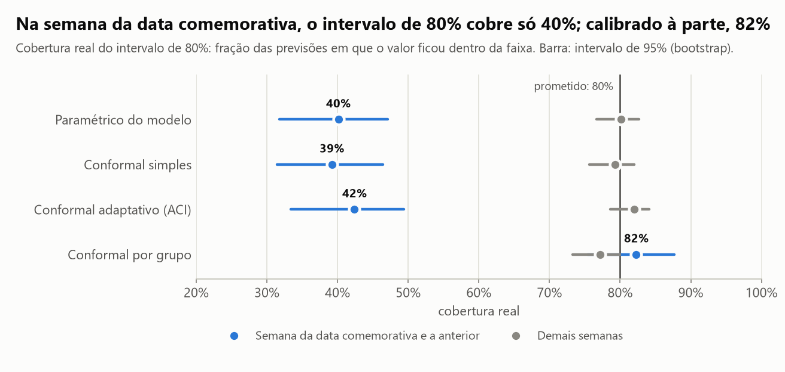
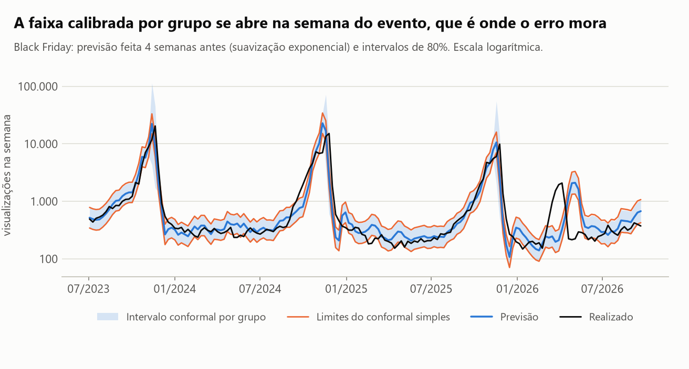
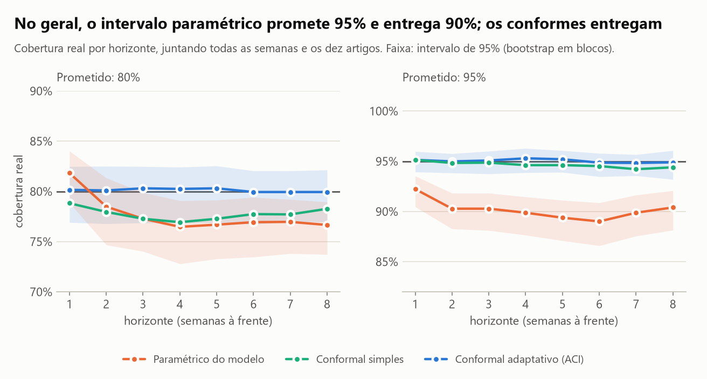
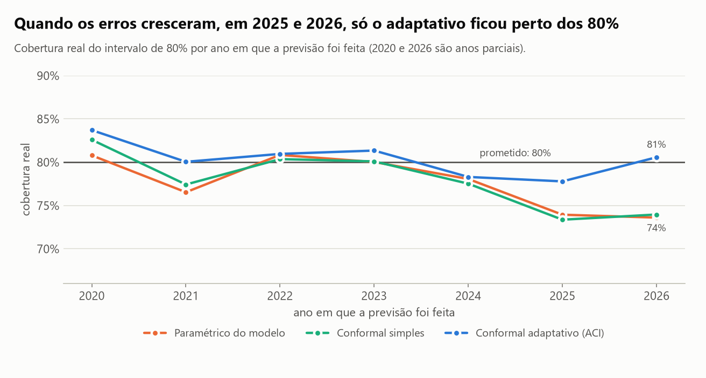
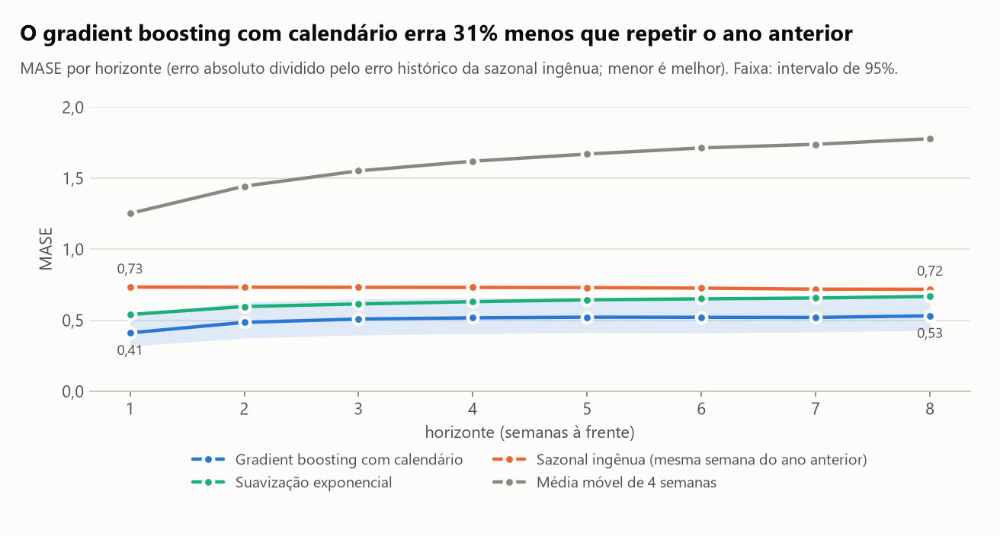
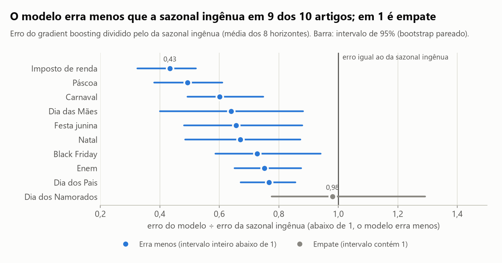

# Quanto interesse vai haver nas próximas semanas, e quanto dá para confiar na previsão?

Dá para prever melhor do que repetir o ano passado: um gradient boosting com variáveis de calendário erra **31%
menos** que a sazonal ingênua (intervalo de 95%: 25% a 39%). Já a faixa de erro só é honesta na média: o intervalo
de 80% cobre entre 78% e 80% das semanas no geral e apenas **40% na semana da data comemorativa**, que é a que
decide a verba. Calibrando essas semanas à parte, a cobertura volta a 82%, e o preço aparece: a faixa deixa de ser
"previsão ÷1,7 a ×1,7" e passa a "÷4,2 a ×4,2".

A base são visualizações semanais de dez artigos da Wikipédia em português (Black Friday, Dia das Mães, Natal,
Páscoa, Carnaval e outros), de 2015 a 2026. **Visualização de artigo é um indicador de interesse, não de venda:**
ela entra aqui como série pública, longa e sazonal para testar o método que eu usaria numa série de demanda.

## Em 30 segundos

- **A pergunta tem duas metades.** Quem planeja verba e estoque para uma data precisa da previsão e de saber quanto
  ela pode errar. Este estudo mede as duas, do jeito que seriam usadas: prevendo de 1 a 8 semanas à frente, 323
  vezes seguidas, sempre só com o passado.
- **Previsão.** O gradient boosting com calendário erra 31% menos que "a mesma semana do ano anterior" e ganha em 9
  dos 10 artigos (no décimo, empate). A suavização exponencial erra 14% menos e empata a partir de 6 semanas. A média
  móvel erra mais que o dobro.
- **Confiança, no geral.** O intervalo paramétrico do modelo promete 95% e entrega 90%. Os intervalos por predição
  conforme entregam 95%. No nível de 80%, todos ficam entre 78% e 80%.
- **Confiança, na semana que importa.** Na semana da data comemorativa e na anterior, o intervalo de 80% cobre de
  39% a 42%, conforme o método. Nenhum dos três alarga a faixa quando a data se aproxima, e o erro mora no pico.
- **O conserto e o preço.** Calibrar as semanas de evento à parte leva a cobertura a 82% com uma faixa de ÷4,2 a
  ×4,2. Em volta do gradient boosting, que prevê melhor o pico, a mesma calibração dá 84% com ÷2,9 a ×2,9.
- **O adaptativo.** Quando os erros cresceram, em 2025 e 2026, só o intervalo adaptativo (ACI) ficou perto dos 80%
  (78% e 81%, contra 73% e 74% do conformal simples). A 95% ele cobra caro: 13% dos intervalos são infinitos.

## As figuras

### 1. Na média o intervalo cumpre; na semana do evento, não



Cada linha é um jeito de construir o intervalo de 80% em volta da mesma previsão. O ponto cinza é a cobertura real
nas semanas comuns; o azul, nas semanas em que a previsão mira a data comemorativa do artigo ou a semana anterior
(875 previsões, contra 19.797 nas demais). Os três primeiros métodos ficam perto de 80% nas semanas comuns e perto
de 40% nas de evento. A garantia da predição conforme é na média de todas as previsões, e a média é dominada pelas
semanas fáceis. Na última linha, as semanas de evento são calibradas só com erros de semanas de evento, e a cobertura volta
a 82%.

| Como o intervalo de 80% é construído | Semana de evento | IC 95% | Demais semanas | IC 95% | Faixa na semana de evento |
| --- | --- | --- | --- | --- | --- |
| Paramétrico do modelo | 40% | 32% a 47% | 80% | 77% a 83% | ÷1,6 a ×1,6 |
| Conformal simples | 39% | 31% a 46% | 79% | 76% a 82% | ÷1,7 a ×1,7 |
| Conformal adaptativo (ACI) | 42% | 33% a 49% | 82% | 79% a 84% | ÷1,7 a ×1,7 |
| Conformal por grupo | 82% | 75% a 88% | 77% | 73% a 80% | ÷4,2 a ×4,2 |

No nível de 95% a história se repete: 57%, 67% e 68% nas semanas de evento. Calibrado por grupo, 96%, com uma faixa
de ÷16 a ×16. Essa largura é a resposta honesta para "quanto dá para confiar na previsão do pico": pouco.

### 2. A faixa que se abre onde o erro mora



Black Friday, previsão feita 4 semanas antes. As linhas laranja são os limites do conformal simples: praticamente a
mesma largura o ano inteiro. A faixa azul é a calibrada por grupo: quase igual à outra nas semanas comuns, muito
mais larga nas duas semanas do evento. Dá para ver por que a largura fixa falha: a previsão sobe e desce junto com o realizado, mas
basta o pico chegar uma semana antes ou depois do previsto para o erro ser de várias vezes o valor.

### 3. No geral, o paramétrico promete mais do que entrega



Juntando todas as semanas e os dez artigos. À direita, o nível de 95%: o intervalo paramétrico (normal, com a
variância que o modelo estimou) cobre 90% (IC 95%: 88% a 92%); os dois conformes ficam em 95%. À esquerda, o nível
de 80%: os três ficam próximos, e só o adaptativo crava o prometido em todos os horizontes.

| Método | Promete 80%, entrega | IC 95% | Promete 95%, entrega | IC 95% | Intervalos infinitos a 95% |
| --- | --- | --- | --- | --- | --- |
| Paramétrico do modelo | 77,7% | 74,6% a 80,0% | 90,2% | 88,1% a 91,7% | 0% |
| Conformal simples | 77,7% | 74,5% a 80,2% | 94,6% | 93,2% a 95,7% | 0% |
| Conformal adaptativo (ACI) | 80,1% | 77,1% a 82,2% | 95,0% | 93,9% a 95,8% | 13,0% |
| Conformal por grupo | 77,6% | 74,3% a 80,1% | 94,7% | 93,2% a 95,8% | 0% |

A última coluna é o custo do adaptativo: para segurar 95% depois de uma sequência de erros, ele responde "não sei"
(intervalo infinito) em 13% das previsões. Com um passo de correção menor (0,005 em vez de 0,02) seriam 1,3%, com
cobertura de 94,8%.

### 4. Quando os erros mudam de tamanho



O conformal simples supõe que os erros de amanhã se parecem com os de ontem. Em 2025 e 2026 os erros cresceram, e
ele e o paramétrico caíram para perto de 74%. O adaptativo corrige o nível a cada erro observado e ficou em 78% e 81%.
É para isso que ele serve, e não mais do que isso: na semana de evento ele cobre 42%, como os outros.

### 5. A previsão pontual: o calendário ganha da sazonal ingênua



MASE por horizonte: o erro absoluto dividido pelo erro histórico da sazonal ingênua, com cada artigo pesando igual.
O gradient boosting fica abaixo da sazonal ingênua em todos os horizontes; o ganho é maior a 1 semana (0,41 contra
0,73) e se estabiliza perto de 0,52 a partir de 4 semanas. A média móvel não serve para série sazonal: chega atrasada
em todo pico.

### 6. Onde o modelo ganha



| Artigo | MASE sazonal ingênua | MASE gradient boosting | Razão | IC 95% |
| --- | --- | --- | --- | --- |
| Imposto de renda | 0,55 | 0,24 | 0,43 | 0,32 a 0,52 |
| Páscoa | 0,48 | 0,24 | 0,49 | 0,38 a 0,61 |
| Carnaval | 0,40 | 0,24 | 0,60 | 0,49 a 0,75 |
| Dia das Mães | 1,42 | 0,91 | 0,64 | 0,40 a 0,88 |
| Festa junina | 0,27 | 0,18 | 0,66 | 0,48 a 0,88 |
| Natal | 0,87 | 0,58 | 0,67 | 0,49 a 0,87 |
| Black Friday | 0,46 | 0,33 | 0,73 | 0,59 a 0,94 |
| Enem | 0,33 | 0,25 | 0,75 | 0,65 a 0,87 |
| Dia dos Pais | 1,84 | 1,41 | 0,77 | 0,67 a 0,86 |
| Dia dos Namorados | 0,65 | 0,63 | 0,98 | 0,78 a 1,29 |

Os maiores ganhos estão onde a sazonal ingênua mais sofre: nas datas móveis (Páscoa e Carnaval mudam de semana a
cada ano, e "52 semanas atrás" erra o pico) e no Imposto de renda, que não tem pico fixo e é melhor previsto pelo
nível recente. Em Dia dos Namorados é empate.

## Como foi feito

1. **Dados.** Visualizações diárias de dez artigos pela API pública de pageviews da Wikimedia (licença CC0), de
   01/07/2015 a 31/10/2026, só acessos de pessoas (sem robôs). Agregadas em 590 semanas completas, de segunda a
   domingo; 20,9 milhões de visualizações. Critério de escolha: tema de consumo com sazonalidade, título canônico e
   série sem nenhum dia faltando ("Dia das Crianças" e "Dia das Bruxas" foram descartados por terem dias sem
   registro).
2. **Validação por origem móvel.** A origem é a semana em que a previsão é feita. Em cada origem o modelo vê só o
   passado e prevê as 8 semanas seguintes; a origem anda uma semana e tudo se repete. São 427 origens: as 104
   primeiras só juntam erros para calibrar os intervalos (aquecimento) e as 323 seguintes, de junho de 2020 a agosto
   de 2026, entram nas métricas (25.840 previsões por modelo). Os modelos são reestimados a cada 13 semanas. Um
   teste troca todos os valores futuros e confere que nenhuma previsão muda.
3. **Linhas de base.** Sazonal ingênua (a mesma semana do ano anterior) e média móvel de 4 semanas.
4. **Modelos.** Suavização exponencial com sazonalidade aditiva em `log(1 + y)` (ETS do `statsmodels`) e gradient
   boosting (LightGBM), um modelo por horizonte para os dez artigos, com defasagens, a mesma semana do ano anterior e
   o calendário da semana prevista: distância até Carnaval, Páscoa, Dia das Mães, Dia dos Pais, Black Friday e as
   datas fixas, todas calculadas no código, mais o valor da semana que estava à mesma distância da data no ano
   anterior.
5. **Métricas.** MASE (cada artigo pesa igual) e erro absoluto percentual ponderado (WAPE, pesa pelo volume), por
   horizonte. Intervalos de 95% por bootstrap em blocos de 13 origens, porque erros de origens vizinhas são
   correlacionados; a comparação entre dois previsores usa as mesmas origens sorteadas para os dois.
6. **Intervalos de previsão.** Em volta da previsão da suavização exponencial, que é o modelo que declara um
   intervalo próprio: (a) paramétrico, normal com a variância do modelo; (b) conformal simples, cujo raio é o
   quantil dos erros fora da amostra já observados; (c) conformal adaptativo (ACI), que corrige o nível a cada
   erro; (d) conformal por grupo, que calibra as semanas de evento à parte. Os três conformes estão em NumPy, em
   `src/previsao_demanda/conformal.py`. Com horizonte h, o erro de uma previsão só é conhecido h semanas depois, e a
   calibração respeita esse atraso.
7. **Testes.** As funções de método são conferidas contra casos de resposta conhecida: a cobertura exata do
   conformal com erros permutáveis, o limite teórico da ACI numa sequência adversária, a recuperação depois de uma
   mudança de regime, a cobertura por grupo com dois grupos de variância conhecida, as datas móveis contra o
   calendário real e a fórmula do intervalo paramétrico contra o `statsmodels`.

O que foi decidido antes e o que foi decidido depois de ver resultado:

- Fixados antes de olhar a janela de avaliação: horizontes, janelas, o passo da ACI (0,02), a definição de semana de
  evento (a da data e a anterior) e os hiperparâmetros do gradient boosting, sem busca (o número de árvores e a taxa
  de aprendizado foram escolhidos pelo tempo de execução).
- Uma comparação de variantes (perda L1 contra L2) foi feita só nas origens de aquecimento e deu empate.
- O tamanho mínimo de folha do gradient boosting foi reduzido de 20 para 5 depois que um teste sintético mostrou que
  folhas de 20 linhas não isolam uma data que acontece uma vez por ano. Na janela de avaliação o resultado é o
  mesmo com os dois valores: razão de 0,69 para a sazonal ingênua.
- **O conformal por grupo não estava no plano.** Foi acrescentado depois de ver a cobertura de 40% nas semanas de
  evento. O número dele (82%) deve ser lido como exploratório.

## Comparação com a alternativa simples

Previsão pontual, na média dos 8 horizontes (323 origens, 10 artigos):

| Previsor | MASE | IC 95% | WAPE | Erro em relação à sazonal ingênua | IC 95% | Veredito |
| --- | --- | --- | --- | --- | --- | --- |
| Sazonal ingênua (linha de base) | 0,73 | 0,61 a 0,89 | 65% | 1,00 | | linha de base |
| Média móvel de 4 semanas (linha de base) | 1,60 | 1,34 a 1,89 | 125% | 2,19 | 1,89 a 2,44 | erra mais |
| Suavização exponencial | 0,63 | 0,53 a 0,76 | 54% | 0,86 | 0,78 a 0,95 | erra menos |
| Gradient boosting com calendário | 0,50 | 0,40 a 0,63 | 43% | 0,69 | 0,61 a 0,75 | erra menos |

A sazonal ingênua é uma linha de base séria, e aqui ela perde. A suavização exponencial só ganha dela até 5 semanas
à frente; de 6 a 8 semanas o intervalo da razão contém 1, e é empate. Mesmo o melhor previsor tem WAPE de 43%:
séries de pico são difíceis, e é por isso que a faixa de erro importa.

Intervalos de 80%, em volta de cada previsor. A alternativa simples é o intervalo que não distingue a semana de
evento das outras (aqui, o adaptativo); a comparação é com o calibrado por grupo:

| Previsor | Método | Cobertura geral | Cobertura na semana de evento | IC 95% | Faixa na semana de evento |
| --- | --- | --- | --- | --- | --- |
| Sazonal ingênua | Adaptativo (ACI) | 79% | 58% | 49% a 66% | ÷1,8 a ×1,8 |
| Sazonal ingênua | Por grupo | 73% | 80% | 71% a 88% | ÷3,2 a ×3,2 |
| Suavização exponencial | Adaptativo (ACI) | 80% | 42% | 33% a 49% | ÷1,7 a ×1,7 |
| Suavização exponencial | Por grupo | 78% | 82% | 75% a 88% | ÷4,2 a ×4,2 |
| Gradient boosting | Adaptativo (ACI) | 80% | 61% | 53% a 69% | ÷1,5 a ×1,5 |
| Gradient boosting | Por grupo | 79% | 84% | 77% a 90% | ÷2,9 a ×2,9 |

O método conformal aceita qualquer previsor, e a cobertura geral fica perto do prometido em quase todos. O que muda
é a largura: prever melhor o pico compra uma faixa mais estreita na semana do evento.

## Onde este estudo falha

- **Visualização não é venda.** A série mede quem foi ler sobre o assunto. O formato do pico é parecido com o de uma
  série de demanda, mas nada aqui diz quanto vender. E a Wikipédia em português é lida também fora do Brasil: o
  artigo "Dia dos Namorados" tem o maior pico em fevereiro (São Valentim), não em junho.
- **Dez séries escolhidas a dedo**, todas com sazonalidade forte. Nada aqui diz se o calendário ajudaria num produto
  sem data marcada.
- **O conformal por grupo foi desenhado depois de ver a falha**, na mesma janela em que é avaliado. Ele não tem
  parâmetro ajustado, mas a confirmação de verdade exige dados novos. E a calibração das semanas de evento junta os
  artigos: a cobertura de 82% é do conjunto, não de cada artigo.
- **São poucas semanas de evento.** As 875 previsões vêm de cerca de 110 semanas de evento distintas, cada uma vista
  de 8 horizontes. O bootstrap em blocos leva isso em conta, e por isso o intervalo é largo (32% a 47%).
- **A faixa honesta do pico é larga demais para planejar.** De ÷4,2 a ×4,2 a 80%, e de ÷16 a ×16 a 95%. O conformal
  mede a incerteza, não a reduz. Só prever melhor o pico reduz, e mesmo o gradient boosting fica em ÷2,9 a ×2,9.
- **Nas semanas comuns, o método por grupo fica abaixo do prometido:** 77% (IC 95%: 73% a 80%). Os erros cresceram
  em 2025 e 2026 e ele não se adapta. Juntar a calibração por grupo com a correção adaptativa é o próximo passo, e
  não foi testado.
- **O adaptativo garante a cobertura no longo prazo, não em cada semana**, e a 95% entrega 13% de intervalos
  infinitos com o passo fixado. O passo não foi ajustado; a tabela de sensibilidade está em `reports/resultados.json`.
- **A suavização exponencial testada é a básica:** período de 52 semanas, estados iniciais por heurística, sem
  tendência. Um ano tem 52,18 semanas e as datas móveis mudam de semana, então um padrão sazonal de 52 semanas pode
  pôr o pico na semana errada. SARIMA e modelos com regressores de calendário não foram testados.
- **O gradient boosting não teve busca de hiperparâmetros**, e é reestimado só a cada 13 semanas.
- **Imposto de renda e Enem ficaram fora do recorte de eventos:** o prazo e a data da prova mudam por lei e por
  edital e não dá para calcular no código. Para esses dois o modelo também não recebe calendário próprio.
- **A definição de semana de evento** (a da data e a anterior) é uma escolha. Outras janelas não foram testadas.
- **A janela de avaliação começa em junho de 2020** e inclui a pandemia. Não separei esse período para ver se os
  resultados mudam sem ele.

## Como rodar

Pré-requisito: [`uv`](https://docs.astral.sh/uv/getting-started/installation/).

```bash
uv sync
uv run python scripts/baixar_dados.py     # baixa da API da Wikimedia e regrava data/visualizacoes_semanais.csv
uv run python scripts/rodar_analise.py    # regera reports/resultados.json e as figuras (cerca de 3 minutos)
uv run pytest -q -p no:cacheprovider      # 52 testes
```

O extrato semanal está versionado em `data/`, então a análise roda sem rede; o download é opcional e confere o hash
do extrato. O notebook [`analise.ipynb`](analise.ipynb) conta a história com as tabelas.

Fonte dos dados: [API de pageviews da Wikimedia](https://wikimedia.org/api/rest_v1/), pt.wikipedia, acessos de
pessoas, licença [CC0](https://creativecommons.org/publicdomain/zero/1.0/). Código sob licença MIT.

## Como este estudo foi feito

Este estudo foi construído com assistência de IA (Claude Code, da Anthropic), usada como par de programação.
Declaro a divisão do trabalho porque ela importa para quem avalia:

- **Meu:** a direção (quais frentes da ciência de dados estudar e por quê), o contexto de negócio que dá sentido à
  pergunta, vindo de onze anos operando mídia paga e automação, a leitura crítica dos resultados e a decisão do que
  publicar e do que declarar como limitação.
- **Com o assistente:** a formulação da pergunta a partir desse contexto, a escolha da base pública e do método, a
  implementação do código, dos testes e dos gráficos, e a redação, que revisei.
- **Como conferir:** todo número deste README sai de `reports/resultados.json`, gerado por
  `scripts/rodar_analise.py`. Os testes em `tests/` conferem as funções de método contra casos de resposta
  conhecida.

É o mesmo jeito que trabalho nos sistemas que entrego: a IA acelera a implementação, e a responsabilidade pelo que
está escrito aqui é minha.

## Summary (English)

How much interest will there be in the coming weeks, and how far can the forecast be trusted? Using weekly page
views of ten Portuguese-language Wikipedia articles about retail dates (Black Friday, Mother's Day, Christmas,
Easter, Carnival and others; 590 weeks, 2015 to 2026; a proxy for interest, not sales), this study runs a
rolling-origin backtest over 323 weekly origins and horizons of 1 to 8 weeks. A LightGBM model with lags and
calendar features, including the position of moving holidays computed in code, cuts the error by 31% against the
seasonal naive baseline (95% CI 25% to 39%); exponential smoothing cuts 14% and ties beyond 5 weeks. Prediction
intervals are compared at nominal 80% and 95%: the model's parametric interval, split conformal and adaptive
conformal inference (ACI), the conformal methods implemented in NumPy and tested against synthetic data with known
coverage. Overall, the parametric 95% interval covers 90% while both conformal methods deliver 95%. The main
finding is conditional: in the holiday week and the week before, every fixed-width 80% interval covers only about
40%. Calibrating holiday weeks as a separate group restores 82% coverage, at the price of a band from ÷4.2 to ×4.2
around the forecast. That variant was added after seeing the failure and is reported as exploratory. Code, tests
and notebook are in Portuguese.
